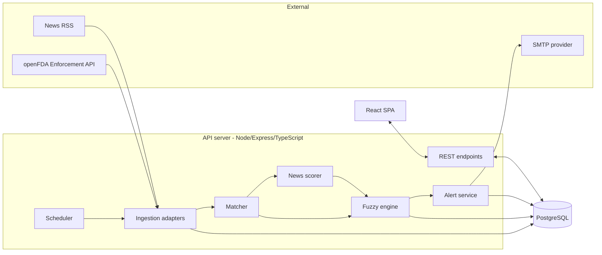
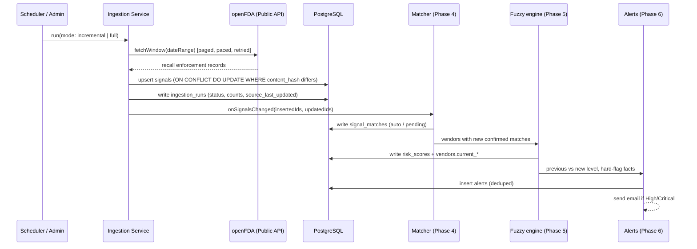

# 04 - Architecture

## 1. Component diagram


## 2. Ingestion & Flagging sequence (E12 Window-Based Architecture)
- **Vendor Privacy**: openFDA is queried strictly for time windows (`report_date:[YYYYMMDD+TO+YYYYMMDD]`). Vendor names never leave the server.
- **Bulk Ingestion**: Records are normalized, hashed (`content_hash`), and upserted in batches into PostgreSQL.
- **Hook Dispatch**: Only inserted and updated signal IDs trigger `onSignalsChanged(insertedIds, updatedIds)` for Phase 4 matching.



## 3. Repository layout
```
vendor-risk-monitor/
├─ apps/
│  ├─ api/
│  │  ├─ prisma/                  # schema + SQL migrations (pg_trgm, indexes)
│  │  └─ src/
│  │     ├─ config/               # env parsing (Zod)
│  │     ├─ middleware/           # auth, validate, rate-limit, error
│  │     ├─ modules/
│  │     │  ├─ auth/ vendors/ signals/ matching/
│  │     │  ├─ scoring/ alerts/ ingestion/ news/ audit/
│  │     ├─ fuzzy/               # pure engine + default config
│  │     ├─ jobs/                # cron registration
│  │     └─ index.ts
│  └─ web/
│     └─ src/ { pages, components, api, hooks, lib }
├─ docs/
├─ docker-compose.yml
├─ .env.example
└─ README.md
```
Use npm workspaces so API and web share TypeScript types from a `packages/types` folder if desired.

## 4. Deployment topologies
| Mode | Layout | Use |
|---|---|---|
| Self-hosted | Docker Compose: db, api, web on the company's machine/network | Data stays inside the network |
| Hosted demo | Render/Railway: web (static), api, managed Postgres | Presentation link |

Same code, different configuration.

## 5. Boundaries
- Only the API talks to the database and external sources
- The fuzzy engine has no I/O (pure), so it can be tested without a database
- The frontend never calls external sources directly