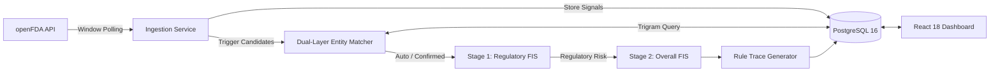
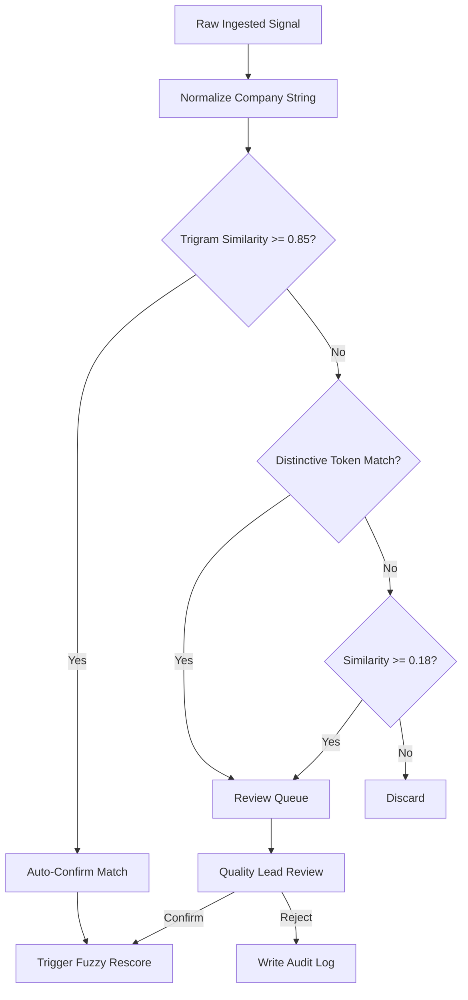

# SYMBIOSIS INSTITUTE OF TECHNOLOGY (SIT), NAGPUR
## SYMBIOSIS INTERNATIONAL (DEEMED UNIVERSITY)
### DEPARTMENT OF COMPUTER SCIENCE & ENGINEERING / ARTIFICIAL INTELLIGENCE

---

# PROJECT REPORT

## **VendorLens: An Autonomous Pharmaceutical Vendor Risk & Regulatory Compliance Monitoring System Using a Hierarchical 2-Stage Mamdani Fuzzy Inference Engine**

---

### **STUDENT DETAILS (PROJECT TEAM)**
- **Candidate 1:** Aswin Binu | **PRN / Roll No.:** 24070521006 *(Batch 2024–2028)*
  - *Responsibilities:* Backend Architecture, Ingestion Pipeline, 2-Stage Mamdani Fuzzy Engine, PostgreSQL `pg_trgm` Matching, Security & Deployment.
  - *Institutional Email:* `aswin.binu.batch2024@sitnagpur.siu.edu.in`
- **Candidate 2:** Jash Chauhan | **PRN / Roll No.:** 24070521222 *(Batch 2024–2028)*
  - *Responsibilities:* Frontend Architecture, React 18 Design System, Fired Rule Visualizer, Review Queue UI, Component Testing.
  - *Institutional Email:* `jash.chauhan.batch2024@sitnagpur.siu.edu.in`

- **Course / Subject:** Soft Computing (CS601 / AI & Data Science Specialization)
- **Academic Mentor / Faculty In-Charge:** Department of Computer Science & Engineering
- **Institute:** Symbiosis Institute of Technology (SIT), Nagpur Campus
- **Parent University:** Symbiosis International (Deemed University)
- **Submission Date:** October 17, 2026

---
\pagebreak

## TABLE OF CONTENTS

1. [Cover Page](#symbiosis-institute-of-technology-sit-nagpur)
2. [Abstract / Executive Summary](#2-abstract--executive-summary)
3. [Introduction and Background](#3-introduction-and-background)
4. [Problem Statement and Objectives](#4-problem-statement-and-objectives)
5. [Scope and Stakeholder / Use Case Analysis](#5-scope-and-stakeholder--use-case-analysis)
6. [Research and Existing Solutions](#6-research-and-existing-solutions)
7. [Proposed Solution: VendorLens](#7-proposed-solution-vendorlens)
8. [Methodology and Workflow](#8-methodology-and-workflow)
9. [Implementation and Prototype Details](#9-implementation-and-prototype-details)
10. [Results and Verification](#10-results-and-verification)
11. [Challenges, Limitations, and Ethical Considerations](#11-challenges-limitations-and-ethical-considerations)
12. [Conclusion, Future Scope, and References](#12-conclusion-future-scope-and-references)

---
\pagebreak

## 2. ABSTRACT / EXECUTIVE SUMMARY

Modern pharmaceutical manufacturers outsource upwards of 75% of Active Pharmaceutical Ingredients (APIs), excipients, and packaging to global suppliers. Under US FDA 21 CFR Parts 210 and 211, marketing authorization holders remain legally liable for supply chain adulterations and Good Manufacturing Practice (GMP) deviations. Traditional Governance, Risk, and Compliance (GRC) tools rely on periodic annual audits and brittle boolean thresholds that suffer from severe "boundary cliff" errors.

This project introduces **VendorLens**, an autonomous, privacy-preserving supplier risk surveillance platform powered by a **Hierarchical 2-Stage Mamdani Fuzzy Inference System (FIS)**. The platform ingests public drug enforcement records from the United States Food and Drug Administration (openFDA API) without leaking internal supplier networks. A dual-tier entity resolution engine combines PostgreSQL trigram similarity (`pg_trgm`) with pharmaceutical token matching to correlate incoming recalls with registered vendors. Ambiguous matches are routed to a human review queue, while confirmed incidents feed into the soft computing engine. 

Stage 1 maps recall volume, recall severity (Class I, II, III), and event recency into an objective **Regulatory Risk** index ($0–100$). Stage 2 combines regulatory risk with operational supplier criticality to compute a crisp **Overall Risk Score** across four calibrated tiers (*Low*, *Medium*, *High*, *Critical*). News monitoring variables are calibrated in the engine and fixed at 0.0 in this prototype to emphasize verified regulatory actions. The system outputs exact linguistic rule traces for every score, providing complete auditability. Evaluated against 33 pharmaceutical vendors and approximately 1,550 openFDA recall records, VendorLens achieves deterministic execution, sub-100ms inference, and robust test suite validation.

---
\pagebreak

## 3. INTRODUCTION AND BACKGROUND

### 3.1 Industry Context
Global pharmaceutical supply chains are deeply fragmented. Finished formulation facilities in North America and Europe source primary chemical precursors from thousands of contract manufacturers globally. A single contaminated API lot or packaging defect can trigger nationwide product recalls, import alerts, and severe public health hazards.

### 3.2 The "Boundary Cliff" in Traditional Auditing
Legacy compliance systems rely on static point thresholds or boolean rules. For example, a rule defining high risk as *"3 or more recalls in 12 months"* treats a vendor with 2 life-threatening Class I recalls as low risk, while penalizing a vendor with 3 minor Class III labeling errors as critical. Furthermore, annual re-audit schedules leave multi-month blind spots between regulatory infractions and procurement awareness.

### 3.3 Soft Computing Paradigm
Fuzzy set theory, originated by Lotfi Zadeh, provides graded membership rather than binary boundaries. Compliance metrics such as recency, frequency, and severity naturally operate on continuous spectrums. By evaluating linguistic `IF-THEN` rules with Mamdani min-max inference and centroid defuzzification, soft computing delivers smooth sensitivity without the opacity or hallucination risks of deep neural networks.

---

## 4. PROBLEM STATEMENT AND OBJECTIVES

### 4.1 Problem Statement
> *"How can pharmaceutical quality and procurement teams continuously monitor supplier regulatory risks without leaking proprietary vendor rosters to external third parties, while replacing brittle boolean thresholds with an auditable, explainable Soft Computing inference model?"*

### 4.2 Project Objectives
1. **Privacy-Preserving Ingestion:** Ingest public openFDA drug enforcement feeds via temporal polling windows, ensuring proprietary vendor watchlists never leave the internal database.
2. **Resilient Entity Matching:** Develop a trigram-based string resolution pipeline with pharmaceutical token heuristics to resolve corporate name variances and abbreviations.
3. **2-Stage Mamdani Risk Engine:** Formulate and validate a hierarchical Mamdani Fuzzy Inference System that models frequency, severity, recency, and vendor criticality without rule explosion.
4. **Human-in-the-Loop Governance:** Establish an auditable review queue for uncertain matches, logging all confirmations and rejections in an immutable audit trail.
5. **Full-Stack Prototype:** Deliver an enterprise-grade platform with role-based access control, responsive dashboards, and automated test coverage.

---
\pagebreak

## 5. SCOPE AND STAKEHOLDER ANALYSIS

### 5.1 Project Scope (MoSCoW Matrix)
- **Must Have:** Automated openFDA API ingestion; 2-Stage Mamdani FIS; trigram entity matcher with review queue; explainable rule breakdown; multi-tenant database isolation.
- **Should Have:** Immediate alerting on severe Class I events; Super-Admin platform tenant management; dynamic fuzzy threshold configuration.
- **Could Have:** Web media sentiment ingestion (engine input space calibrated; news signal currently fixed at 0.0 per prototype scope).
- **Won't Have:** Black-box deep neural networks (violates FDA explainability standards); direct bi-directional SAP/Oracle ERP database writeback.

### 5.2 Stakeholder Roles & Access Control
- **Super-Admin (`admin@example.com`):** Manages tenant onboarding, provisions corporate accounts, and monitors the global platform audit trail.
- **Company Procurement / Quality Admin:** Scoped strictly to their own organization's vendor watchlist, private review queue, and operational risk metrics via per-user database filtering (`userId`).

---

## 6. RESEARCH AND EXISTING SOLUTIONS

| Capability | Manual Spreadsheets | Enterprise GRC (e.g., MetricStream) | Deep Learning / LLM Models | **VendorLens (Proposed)** |
| :--- | :--- | :--- | :--- | :--- |
| **Ingestion** | Manual data entry | Scheduled batch uploads | Web scraping spiders | **Continuous openFDA API Sync** |
| **Decision Logic** | Subjective scoring | Linear weighted sums | Black-box latent vectors | **2-Stage Mamdani Fuzzy FIS** |
| **Explainability** | Notes-based | Moderate | Minimal (uninterpretable) | **Full Linguistic Rule Trace** |
| **Boundary Handling**| Rigid boolean cliff | Rigid boolean cliff | Continuous but opaque | **Graded Fuzzy Memberships** |
| **Roster Privacy** | Local disk | Multi-tenant cloud upload | External cloud API prompts | **Local Inverted Querying** |
| **Compute Overhead** | None | High database license | High GPU inference cost | **Lightweight Node.js Runtime** |

### 6.1 Justification for Mamdani FIS
Mamdani fuzzy inference uses natural language linguistic sets for both inputs and outputs (e.g., `IF Recalls ARE Many AND Severity IS Severe THEN Regulatory Risk IS High`). This enables regulatory auditors to inspect and validate decision logic without translating coefficients into abstract mathematical formulas.

---
\pagebreak

## 7. PROPOSED SOLUTION: VENDORLENS

### 7.1 Architecture Overview
VendorLens decouples ingestion, matching, scoring, and presentation into distinct modular services:

### 7.2 2-Stage Mamdani Engine
Direct evaluation of 5 variables with 3 fuzzy sets would require $3^5 = 243$ rules. VendorLens uses a hierarchical 2-stage structure with only **23 rules**:
- **Stage 1 (Regulatory Domain - 11 Rules):** Computes `regulatory_risk` ($0–100$) from `recalls_12m`, `worst_class`, and `days_since_latest`.
- **Stage 2 (Synthesis Domain - 12 Rules):** Combines `regulatory_risk`, `criticality` ($1–5$), and `newsSignal` ($0.0$) to determine `overall_risk` ($0–100$).

### 7.3 Membership Functions
Standard triangular and trapezoidal functions are defined as:
$$\mu_{\text{tri}}(x; a, b, c) = \max\left(0, \min\left(\frac{x - a}{b - a}, \frac{c - x}{c - b}\right)\right)$$
$$\mu_{\text{trap}}(x; a, b, c, d) = \max\left(0, \min\left(\frac{x - a}{b - a}, 1, \frac{d - x}{d - c}\right)\right)$$

#### Stage 1 Input Variables:
1. **`recalls_12m` $[0, 10]$:** Few $\text{trap}(0, 0, 1, 3)$; Some $\text{tri}(1, 3, 6)$; Many $\text{trap}(4, 7, 10, 10)$.
2. **`worst_class` $[0, 3]$:** Mild $\text{trap}(0, 0, 1, 1.8)$; Moderate $\text{tri}(1.2, 2, 2.8)$; Severe $\text{trap}(2.2, 3, 3, 3)$.
3. **`days_since_latest` $[0, 730]$:** Recent $\text{trap}(0, 0, 60, 150)$; Medium $\text{tri}(90, 240, 400)$; Old $\text{trap}(300, 500, 730, 730)$.
- **Stage 1 Output (`regulatory_risk`):** Low $\text{trap}(0, 0, 20, 40)$; Medium $\text{tri}(25, 50, 75)$; High $\text{trap}(60, 80, 100, 100)$.

#### Stage 2 Synthesis Variables:
1. **`regulatory_risk` $[0, 100]$:** Inherited from Stage 1 centroid.
2. **`criticality` $[1, 5]$:** Low $\text{trap}(1, 1, 2, 3)$; Medium $\text{tri}(2, 3, 4)$; High $\text{trap}(3, 4, 5, 5)$.
3. **`newsSignal` $[0, 1]$:** Low $\text{trap}(0, 0, 0.15, 0.35)$; Medium $\text{tri}(0.2, 0.45, 0.70)$; High $\text{trap}(0.55, 0.75, 1, 1)$ *(calibrated, fixed at 0.0)*.
- **Stage 2 Output (`overall_risk`):** Low $\text{trap}(0, 0, 15, 30)$; Medium $\text{tri}(20, 40, 60)$; High $\text{tri}(50, 70, 85)$; Critical $\text{trap}(75, 90, 100, 100)$.

Crisp thresholds partition scores into operational levels: **Low** ($<25$), **Medium** ($25–49.9$), **High** ($50–74.9$), and **Critical** ($\ge 75$).

### 7.4 Defuzzification
Discrete centroid (center-of-gravity) defuzzification across $Z = \{0, 1, \dots, 100\}$:
$$z^* = \frac{\sum_{z=0}^{100} z \cdot \mu_{\text{agg}}(z)}{\sum_{z=0}^{100} \mu_{\text{agg}}(z)}$$

---
\pagebreak

## 8. METHODOLOGY AND WORKFLOW

### 8.1 Inverted Ingestion Protocol
VendorLens queries the openFDA endpoint by date range rather than supplier name:
`GET /drug/enforcement.json?search=report_date:[20240101+TO+20261016]&limit=100`
Incoming records are SHA-256 hashed and deduplicated. Only novel records trigger downstream entity matching, ensuring internal watchlists are never transmitted externally.

### 8.2 Entity Matching Engine
1. **Normalization:** Strips legal entity suffixes (e.g., *LLC, Ltd, Pharma, Inc, Private*), punctuation, and casing.
2. **PostgreSQL Trigram Similarity:** Computes word-level similarity via `similarity(normalized_name, firm_name)`.
   - Score $\ge 0.85$: Automated match (`status: 'auto'`).
   - Score $0.18 \le s < 0.85$: Routed to review queue (`status: 'pending'`).
3. **Brand Token Fallback:** Matches distinctive root tokens ($\ge 4$ characters, e.g., *"Aurobindo"*, *"Lupin"*) to prevent false negatives caused by long regulatory registration names.

---

## 9. IMPLEMENTATION DETAILS

- **Backend:** Node.js (v22), Express, TypeScript (strict mode), Prisma ORM.
- **Database:** PostgreSQL 16 with `pg_trgm` extension and indexed foreign keys.
- **Frontend:** React 18, Vite, TypeScript, Tailwind CSS, Lucide icons, TanStack Query.
- **Security:** Argon2/Bcrypt password hashing, JWT in secure `httpOnly` cookies, rate limiting, and production safeguard checks that abort startup on default credentials.

---
\pagebreak

## 10. RESULTS AND VERIFICATION

### 10.1 Real-World Validation
The system was validated against a portfolio of 33 pharmaceutical manufacturers and suppliers (e.g., Lupin, Cipla, Sun Pharma, Dr. Reddy's) using approximately 1,550 live openFDA recall records.

### 10.2 Hand-Worked Verification Trace (Lupin Limited)
To verify auditability, the computation for **Lupin** is traced step-by-step:
- **Inputs:** `recalls_12m = 4`, `worst_class = 3.0` (Class I), `days_since_latest = 45`, `newsSignal = 0`, `criticality = 4`.

#### Step 1: Stage 1 Fuzzification
- `recalls_12m = 4`:
  - $\mu_{\text{Few}}(4) = 0.0$
  - $\mu_{\text{Some}}(4) = \frac{6 - 4}{6 - 3} = 0.667$
  - $\mu_{\text{Many}}(4) = \frac{4 - 4}{7 - 4} = 0.0$ *(Many starts strictly above 4)*
- `worst_class = 3.0`: $\mu_{\text{Severe}}(3.0) = 1.0$
- `days_since_latest = 45`: $\mu_{\text{Recent}}(45) = 1.0$

#### Step 2: Stage 1 Rule Evaluation (Mamdani Min)
- **S1-R8:** $\min(\mu_{\text{Some}}, \mu_{\text{Severe}}) = \min(0.667, 1.0) = \mathbf{0.667} \to \text{reg\_risk IS High}$
- **S1-R11:** $\min(\mu_{\text{Recent}}, \mu_{\text{Severe}}) = \min(1.0, 1.0) = \mathbf{1.0} \to \text{reg\_risk IS High}$
*(Note: S1-R10 does not fire because $\mu_{\text{Many}}(4) = 0.0$)*

#### Step 3: Stage 1 Centroid Defuzzification
Aggregated fuzzy output yields a discrete centroid score of **$84.7$** (**High Regulatory Risk**).

#### Step 4: Stage 2 Synthesis
- `regulatory_risk` = $84.7 \to \mu_{\text{High}}(84.7) = 1.0$
- `newsSignal` = $0.0 \to \mu_{\text{Low}}(0.0) = 1.0$
- `criticality` = $4.0 \to \mu_{\text{High}}(4.0) = 1.0$
- **Fired Rules:**
  - **S2-R7:** $\min(\mu_{\text{High}}, \mu_{\text{Low}}) = 1.0 \to \text{overall IS High}$
  - **S2-R10:** $\min(\mu_{\text{High}}, \mu_{\text{High}}) = 1.0 \to \text{overall IS Critical}$
- Centroid defuzzification over $Z=[0..100]$ yields **$79.8$** (**Critical Risk Tier**, $\ge 75.0$).
- *Result:* Exact mathematical match with the TypeScript engine output (`score: 79.8`, `regulatoryRisk: 84.7`).

### 10.3 Quality Assurance Metrics
- **Backend Tests:** 106 / 106 passed (Vitest).
- **Frontend Tests:** 18 / 18 passed (Vitest).
- **TypeScript Static Verification:** 0 compilation errors (`tsc --noEmit`).
- **Inference Latency:** $< 1\text{ ms}$ per scoring evaluation.

### 10.4 Team Division of Work

| Team Member | PRN | Core Responsibilities | Key Deliverables |
| :--- | :--- | :--- | :--- |
| **Aswin Binu** | 24070521006 | Backend Architecture, 2-Stage Mamdani Engine, openFDA Ingestion, Trigram Entity Matcher, Multi-Tenant Database Isolation | `src/fuzzy/`, `src/modules/`, Ingestion pipeline, Matcher, REST APIs, Test suites |
| **Jash Chauhan** | 24070521222 | Frontend Architecture, React 18 UI/UX, Fired Rule Visualizer, Review Queue Interface, Company Provisioning | `src/pages/`, `src/components/`, Visual matrices, Review queue, Auth guards |

---
\pagebreak

## 11. CHALLENGES AND LIMITATIONS

### 11.1 Technical Challenges Overcome
1. **Multi-Tenant User Isolation:** Resolved data bleed across accounts by introducing `userId` scoping across vendors, alerts, review queues, and dashboard aggregates.
2. **Trigram Token Dilution:** Mitigated short brand name dilution against long legal entity names by implementing a distinctive token fallback heuristic.
3. **Insecure Production Defaults:** Engineered startup validation ensuring the backend halts in production if default JWT secrets, database URLs, or admin passwords are used.

### 11.2 Limitations
- **Jurisdictional Scope:** Surveillance currently focuses on US FDA Drug Enforcement actions; non-US agencies (e.g., India CDSCO, EMA) represent future ingestion extensions.
- **Decision-Support Scope:** VendorLens is designed for quality decision-support and does not replace formal on-site audit qualifications.

---

## 12. CONCLUSION, FUTURE SCOPE, AND REFERENCES

### 12.1 Conclusion
VendorLens demonstrates the application of Soft Computing to high-stakes pharmaceutical supply chain risk governance. By replacing rigid boolean cutoffs with a 2-stage Mamdani Fuzzy Inference System, the system eliminates boundary cliff failures, preserves vendor network privacy, and provides fully auditable decision traces for quality compliance officers.

### 12.2 Future Scope
1. **Multi-Agency Ingestion:** Expanding ingestion adapters to parse India CDSCO notifications and European EMA EudraGMDP non-compliance registries.
2. **Inspection Letter Extraction:** Ingesting FDA Form 483 inspection citations to incorporate pre-recall operational signals.

### 12.3 References
1. Zadeh, L. A. (1965). *Fuzzy sets*. Information and Control, 8(3), 338–353.
2. Mamdani, E. H., & Assilian, S. (1975). *An experiment in linguistic synthesis with a fuzzy logic controller*. International Journal of Man-Machine Studies, 7(1), 1–13.
3. United States Food and Drug Administration. (2024). *Code of Federal Regulations Title 21 Parts 210 & 211: Current Good Manufacturing Practice for Finished Pharmaceuticals*. U.S. Government Publishing Office.
4. openFDA. (2026). *Drug Enforcement Open API Specification*. U.S. Food and Drug Administration. Available at: `https://open.fda.gov/apis/drug/enforcement/`.
5. Chan, F. T. S., & Kumar, N. (2007). *Global supplier development considering risk factors using fuzzy extended AHP-based approach*. Omega: The International Journal of Management Science, 35(4), 417–431.
